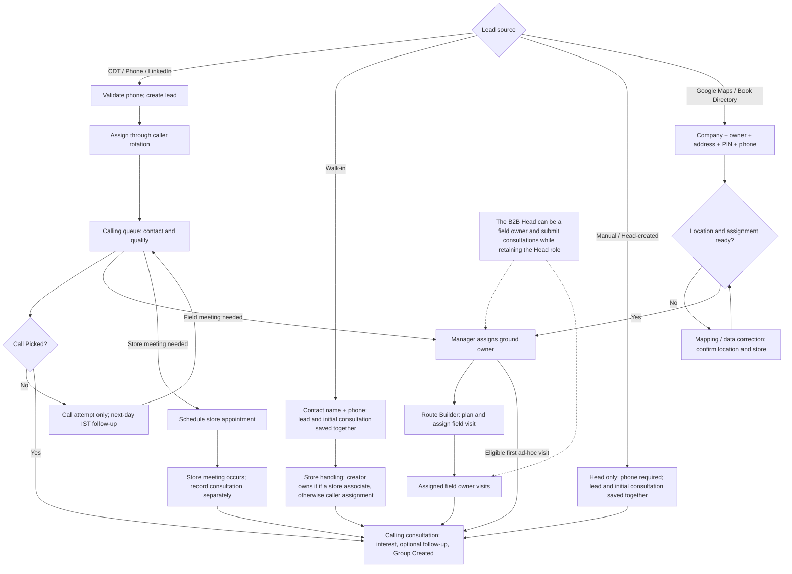
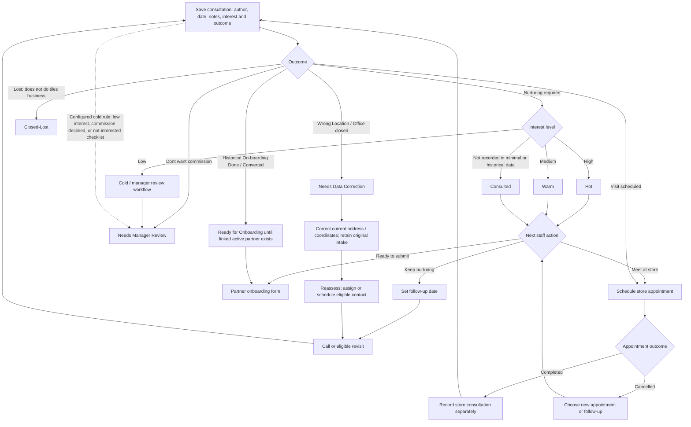
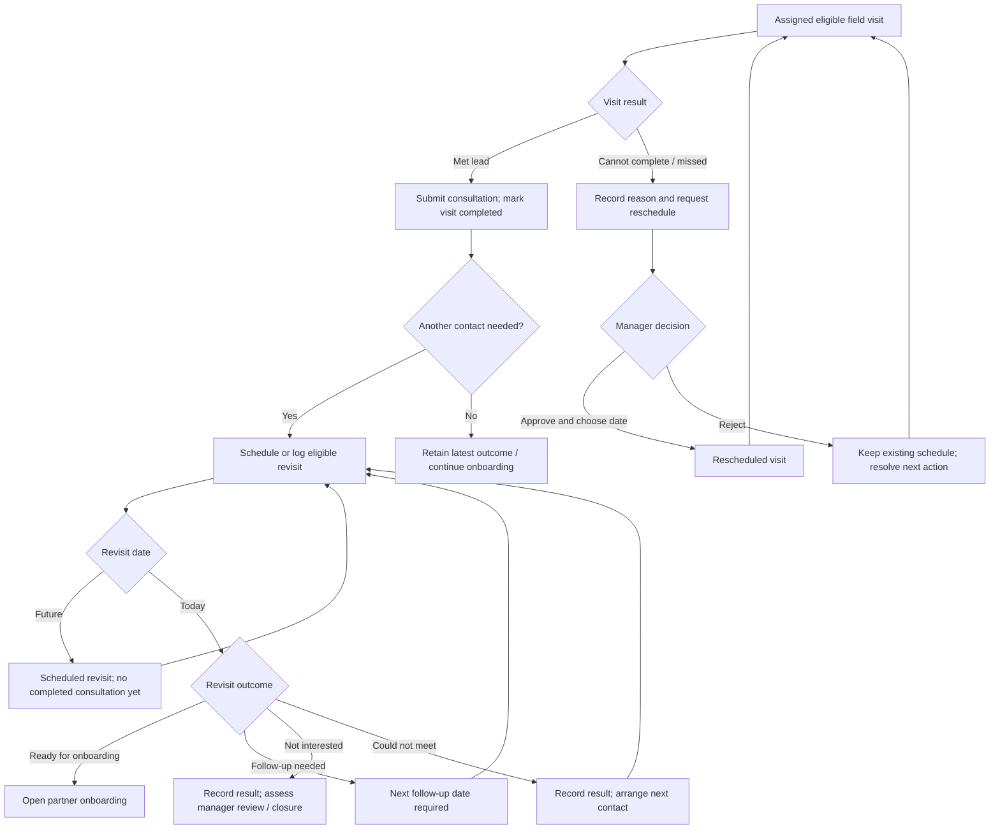
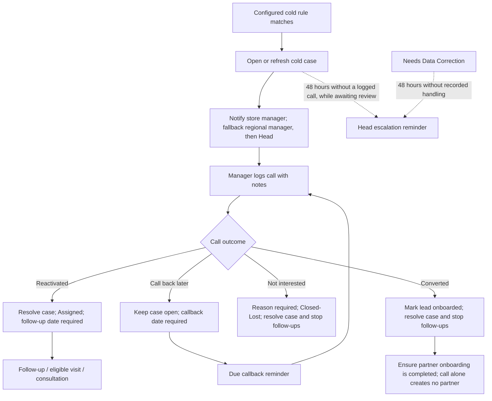
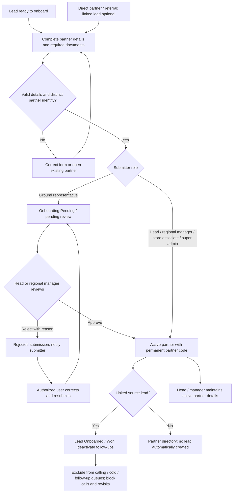
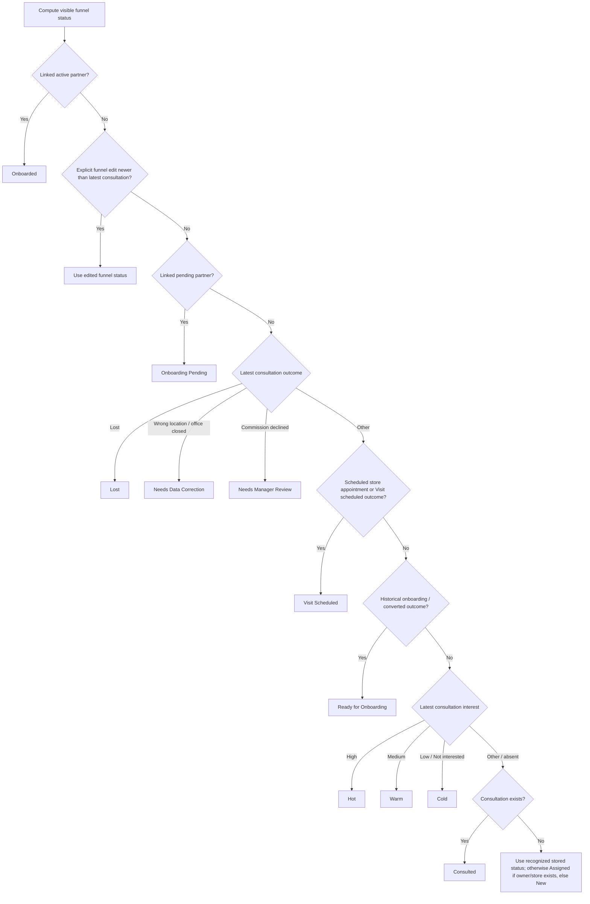

# Lead funnel — complete workflow

Based on the application code as of 14 October 2026. These diagrams describe the implemented paths and the staff actions connecting them. Arrows labelled with an action require that action; they do not imply automatic transitions.

## 1. Source → owner → first consultation

- Intake validation failures return for correction. Duplicate checks direct staff to the existing lead; they do not create a second lead.
- Bulk imports use explicit sources and source-specific fields. Manual and walk-in intake use the single-lead flow so the initial consultation is saved atomically.
- If caller rotation has no eligible staff, assignment needs attention; a field owner is not inferred from the source.
- A scheduled visit belongs to its assigned person: another person, including the Head, cannot file that person's scheduled visit. Assign the visit to the actual submitter. Vineet Shinde is the B2B Head, not a separate ground representative.

## 2. Consultation → outcome → next action

Booking a store appointment does not create a consultation. A follow-up date is a reminder, not a store appointment or field route. Store appointments can also be booked independently of a consultation.

The current consultation form excludes “On-boarding Done”; actual onboarding uses the partner form. Historical records can still contain that outcome. Cold rules exclude final onboarding, lost and location-correction outcomes.

## 3. Field visits, missed visits and repeat consultations

Completed visits cannot be filed again; repeat field work needs an eligible new visit. Caller/store/Head intake owners can append fuller consultations to their own intake records without a ground route. Store-owned revisits use consultation/reminder history rather than ground route visits. A manager may directly reschedule with a date; a representative's request does not change the date until approval.

Revisit outcomes are recorded as history. “Not interested” on the short revisit form is not the same operation as the manager's explicit Closed-Lost action, and the short form does not itself create an active partner.

## 4. Cold-lead recovery and escalation

The Head's cold list also includes latest low-interest consultations, even without an open cold case. The manager-call endpoint requires an active case. Scheduled reminders and escalations require the worker to be running; the migration handoff says production workers are not yet deployed.

## 5. Onboarding, approval, rejection and direct partners

The analyst is read-only. The current partner-create endpoint activates non-ground, non-analyst submissions directly, including store-associate submissions. A referral must point to an active partner. Different named contacts at one company may have separate partner codes; exact company/contact/designation duplicates are rejected. Rejection of an onboarding form is not automatically a lost lead. Existing partner imports can create partner records outside the consultation path.

## 6. How the displayed funnel status is selected

The map/dashboard derives status from current relationships and history; it does not simply display the stored lead status. The first matching rule wins:

### Current implementation caveats

- Manager-call outcomes change the stored status but do not update the latest consultation or create an explicit funnel-status override. A map badge can therefore retain the older consultation's classification after a manager call.
- The short revisit outcome “Ready for onboarding” is not explicitly recognized by the funnel-status resolver; the older “On-boarding Done” / “Converted” values are. A ready revisit can therefore still display its carried-forward interest level.
- Correcting coordinates or completing/cancelling a store appointment does not rewrite an older consultation outcome. A later consultation or supported status action may still be needed to change its displayed classification.
- Active partner linkage takes precedence over these historical labels and overrides. The legacy manager-call “Converted” action does not itself create that linkage.

These are descriptions of current behavior, not changes made as part of this diagram.

### Implementation references

- Intake and creation: `src/lib/leads/intake.ts`, `src/app/api/leads/route.ts`
- Calling: `src/app/api/leads/[id]/calls/route.ts`
- Consultation and visit eligibility: `src/app/api/consultations/route.ts`, `src/lib/routes/consultation-visit.ts`
- Revisit and reschedule: `src/app/api/leads/[id]/revisit/route.ts`, `src/app/api/visits/[id]/reschedule/route.ts`
- Cold rules and recovery: `src/lib/cold/rules.ts`, `src/lib/cold/service.ts`, `src/lib/cold/jobs.ts`, `src/app/api/cold-leads/[id]/calls/route.ts`
- Partner submission/review: `src/app/api/partners/route.ts`, `src/app/api/partners/[id]/route.ts`
- Displayed status: `src/lib/leads/funnel-status.ts`

### Calling form update — 14 October 2026

Calling consultations are distinct from field consultations. Call Picked = No records an attempt and tomorrow's IST follow-up without changing interest or counting a consultation. Yes records only interest, optional follow-up and Group Created; complete information stays in the separate lead-details action. Group Created can be updated later using its checkbox and Apply button. Phone follow-ups do not complete field visits or change their assigned owner.

### Spreadsheet import routing — 14 October 2026

Imported lead source is preserved exactly for context. A lead with valid India coordinates enters the ground/Route Builder pool whether or not it has a phone number. A lead without valid coordinates enters Calling Queue and is hidden from Route Builder; Route Builder reports its count by selected PIN. Once staff complete and verify that lead's location, it moves into the ground route workflow while its source and original intake remain unchanged. Route Builder supports selecting several PINs together and manually searching for an eligible lead by ID, company, contact or phone.
